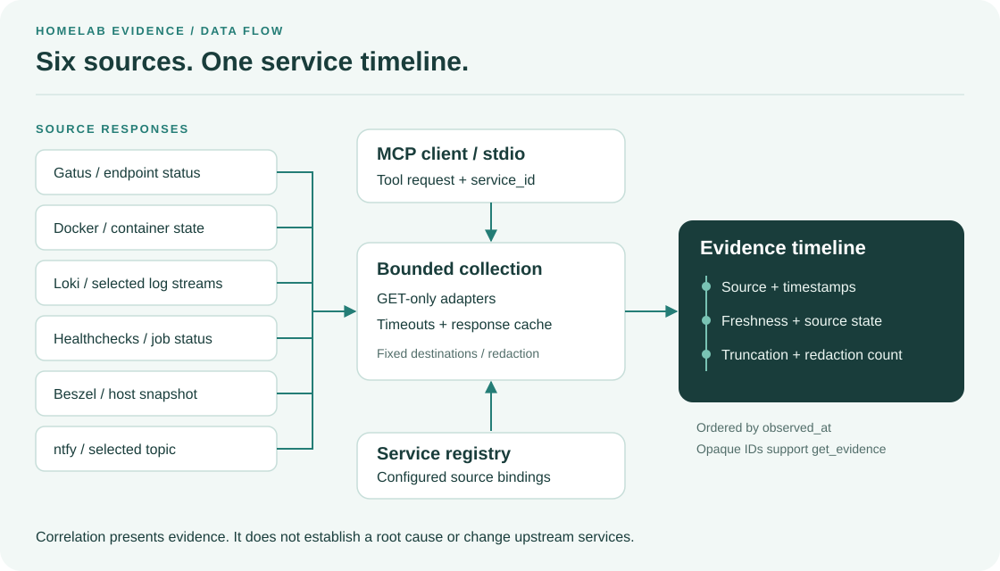

# homelab-evidence-mcp

[](https://github.com/ThomasCrouzet/homelab-evidence-mcp/actions/workflows/ci.yml)
[](LICENSE)

Collect **read-only incident evidence** from six homelab sources through MCP.
One Go binary uses **stdio** and joins source identities through a configured
`service_id`.



The server orders evidence by observation time. Each item includes its source,
timestamps, freshness, redaction count, and truncation state.
Correlation presents facts; it does not establish a root cause.
Destinations remain fixed after startup, and every upstream request uses HTTP `GET`.

## Installation

Prerequisite: Go 1.26.10 is the minimum version.

```bash
go install github.com/ThomasCrouzet/homelab-evidence-mcp/cmd/homelab-evidence-mcp@latest
```

To build from the repository:

```bash
make build
./bin/homelab-evidence-mcp --version
```

## Quick start

1. Copy `config.example.yaml` to a directory that is not in the repository.
2. Restrict access to the owner with `chmod 600 /path/config.yaml`.
   On Windows, use a user-only ACL.
3. Configure source URLs and service bindings.
4. Set each required token through `token_env` or a private `token_file`.
5. Validate the configuration before you add it to the MCP client.

```bash
homelab-evidence-mcp --config /path/config.yaml --validate
```

Validation resolves token references and checks destination settings.
It sends no HTTP requests.
Unknown YAML keys cause an error. A `base_url` cannot contain query strings,
fragments, or userinfo. For Healthchecks, use a read-only API key.

Registration with an MCP client:

```json
{
  "mcpServers": {
    "homelab-evidence": {
      "command": "/path/homelab-evidence-mcp",
      "args": ["--config", "/path/config.yaml"]
    }
  }
}
```

This example uses token files or inherited environment variables.
The server reserves stdout for JSON-RPC and writes logs and audit events to stderr.
It can also write a configured rotating audit file. See
[MCP client configuration](docs/mcp-hosts.md) and the
[integration example](docs/configuration-example.md).

## Source adapters

The server has these source adapters:

- **Gatus**: The adapter uses `GET /api/v1/endpoints/statuses`. It selects the
  result with the greatest timestamp.
- **Docker Engine**: The adapter uses `GET /containers/json?all=true`. It
  filters fields and does not include `Config.Env`.
- **Loki**: The adapter uses `GET /loki/api/v1/query_range`. The configuration
  supplies the selector.
- **Healthchecks**: The adapter uses `GET /api/v3/checks/`. It uses a read-only
  key and does not include ping URLs in its output.
- **Beszel**: The adapter uses `GET /api/systems` and compatible routes. It can
  give a host snapshot.
- **ntfy**: The adapter uses `GET /{topic}/json?poll=1&since=<unix>`. The
  configuration supplies the topic.

Destinations use only `http` and `https`. For Docker, use a read-limited socket
proxy. The Docker Unix socket is not compatible with the server. The server
ignores `HTTP_PROXY` and `HTTPS_PROXY`.

You can use a path prefix in `base_url`. For example, use
`https://proxy.example/gatus` for Gatus. The server keeps `/gatus` before each
Gatus API route.

Set the source cache TTL with `limits.source_cache_ttl`.
The default is `15s`; `0` disables it.
Cache keys use a process-local HMAC instead of clear-text authentication values.
Cache hits retain `observed_at`; `retrieved_at` records the new read time.
Thus, freshness reflects the snapshot's age.

## MCP tools

- `evidence_capabilities` gives the version, active sources, limits, and
  statistics.
- `list_services` gives services in the canonical service registry.
- `service_status` gives a Gatus, Docker, Healthchecks, and Beszel snapshot.
- `incident_context` gives a multi-source timeline with configuration limits.
- `search_logs` examines Loki with the selector in the configuration.
- `failed_crons` gives checks in the `down`, `grace`, or `paused` state.
- `get_evidence` reads temporary evidence again by its opaque identifier.

All tool annotations identify the tools as read-only. Global limits control
windows, HTTP body sizes, evidence counts, and concurrency.

## Evidence model

Each evidence item contains its source and its observation and collection
timestamps. It also contains severity, freshness state, truncation, and the
redaction count. Responses give the `ok`, `absent`, `skipped`, `error`, and
`timeout` state of each source.

See the [evidence model](docs/evidence-model.md) and
[tested API contracts](docs/api-compatibility.md).

## Security

Read [SECURITY.md](SECURITY.md) for guarantees and remaining risks. The primary
security controls are:

- Destinations cannot change after startup.
- The server does not accept HTTP redirects.
- MCP calls cannot supply a URL or stream selector.
- Log content is hostile data.
- The server uses built-in redaction and optional local rules.
- On Unix, give only the owner access to configuration and token files. Use
  mode `0600`.
- On Windows, use a user-only ACL. The binary does not examine Windows ACLs.

## Local demo

```bash
go run ./demo
```

The demo uses local HTTP fixtures and an in-memory MCP session.
It checks source errors, redaction, instruction markers, and GET-only requests.
It does not start the stdio executable or contact a homelab.

Use `make test-e2e` to start the real stdio executable against six local HTTP
fixtures. This suite checks all seven MCP tools and all six adapters.
It does not contact live upstream services.
The runner saves a log and repeatable metadata outside the repository.
Set `HEM_E2E_ARTIFACT_DIR` to select the external artifact directory.
Set `HEM_E2E_BINARY` to the absolute path of a release binary.

## Development

```bash
make test          # race detection and executable E2E tests
make test-e2e      # executable stdio E2E tests
make test-quick    # fast tests
make lint-docs     # Markdown checks
make lint-private  # private Tailscale address check
make lint          # formatting, go vet, and golangci-lint
make coverage
make build
```

CI builds Linux, macOS, and Windows binaries. The primary targets are headless
Linux and macOS systems.

## Documentation

- [Configuration example](docs/configuration-example.md) and [YAML template](config.example.yaml)
- [MCP clients](docs/mcp-hosts.md)
- [Incident playbook](docs/playbook.md)
- [Evidence model](docs/evidence-model.md) and [API compatibility](docs/api-compatibility.md)
- [Contributing](CONTRIBUTING.md) and [Changelog](CHANGELOG.md)

## License

MIT. See [LICENSE](LICENSE).
